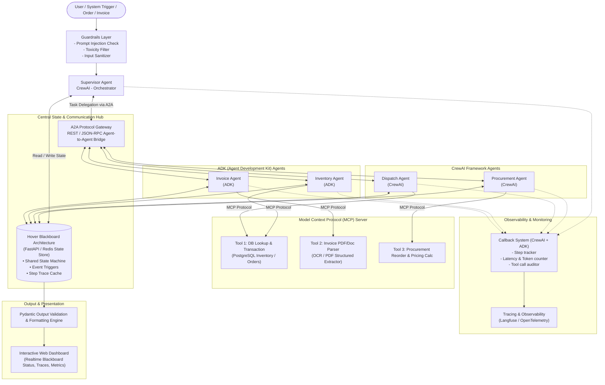
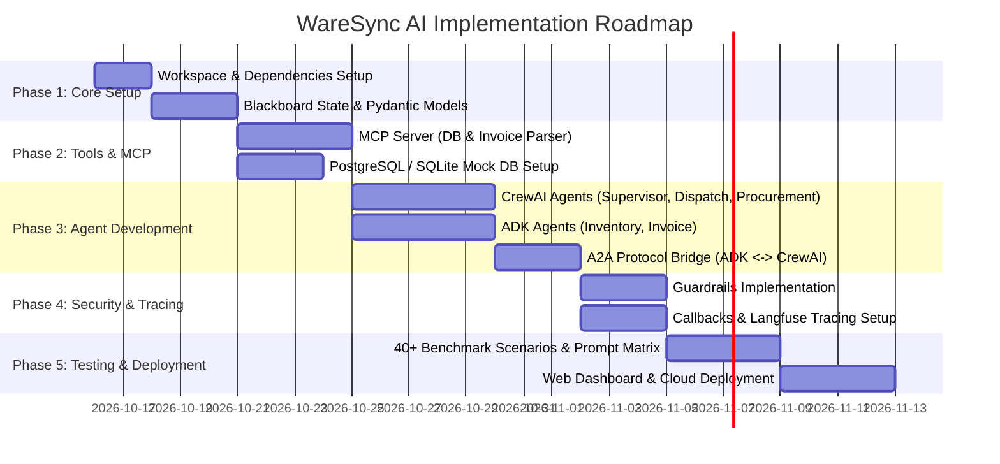

# WareSync AI: Complete System Architecture & Implementation Plan

> **Standardized Multi-Agent Warehouse Operations System**  
> Compliant with all 11 Course Project Review Requirements: **CrewAI + ADK ONLY**, **Hover Blackboard Architecture**, **A2A Protocol**, **MCP Tools**, **Pydantic Validation**, **Guardrails & Prompt Variance**, **Observability**, and **Cloud Deployment**.

---

## 1. Executive System Architecture Overview

The system operates around a central **Hover Blackboard State Manager**, serving as the single source of truth and communication hub for 5 specialized agents split between **CrewAI** and **ADK**.



---

## 2. Requirement-to-Architecture Mapping (The 11 Pillars)

| Requirement | Implementation in WareSync AI | Key Tech / Component |
|---|---|---|
| **1. Context Sharing & Blackboard Architecture** | A central Blackboard state engine maintaining operational context (inventory levels, order queue, invoice validation status). Agents post intermediate outputs and subscribe to state changes. Compare Blackboard vs Direct Message passing. | FastAPI + Redis / In-Memory Blackboard with pub/sub hooks |
| **2. MCP Tool Integration** | Standardized Model Context Protocol (MCP) server providing at least 2 external tools: (1) PostgreSQL DB tool for stock/order queries, (2) Invoice Document OCR/PDF parser. | FastMCP / Official Python MCP SDK |
| **3. Structured Output using Pydantic** | All agent inputs, intermediate states, and final user reports strictly conform to Pydantic schemas (JSON, formatted markdown, and tabular summaries). | Pydantic v2 schemas for all Agent Outputs |
| **4. Agentic Design Patterns** | Implement **Evaluator-Optimizer (Reflection)** for invoice/PO matching, **ReAct pattern**, and compare **Sequential vs. Hierarchical vs. Event-driven** architectures. | CrewAI Hierarchical Flow + ADK reactive loop |
| **5. Task Monitoring & Logging Callbacks** | Custom lifecycle callbacks on both CrewAI (`on_task_start`, `on_tool_end`) and ADK to log intermediate steps, tool latencies, and errors to the blackboard. | CrewAI Callbacks + ADK Event Listeners |
| **6. A2A Protocol Interoperability** | Uniform Agent-to-Agent communication protocol allowing CrewAI agents and ADK agents to send messages, delegate subtasks, and exchange payload packets seamlessly. | JSON-RPC / REST A2A envelope protocol |
| **7. Framework Compliance: CrewAI + ADK Only** | **CrewAI**: Supervisor Agent, Procurement Agent, Dispatch Agent.<br>**ADK**: Inventory Agent, Invoice Processing Agent. | `crewai`, `google-adk` (or Python ADK runtime) |
| **8. Security, Guardrails & Prompt Variance** | (a) Input sanitization, prompt injection detection, output validation.<br>(b) Tool argument type-guards.<br>(c) Explicit prompt variance testing (ReAct vs Few-Shot prompts; Auditor persona vs Express persona). | Guardrails AI / Pydantic validators + Custom variance benchmark matrix |
| **9. Observability & Tracing** | Full tracing of prompt tokens, completion tokens, call latencies, agent step transitions, and tool calls. | Langfuse / OpenTelemetry integration |
| **10. E2E Performance, Cost & Latency Benchmark** | Automated evaluation script testing 40+ warehouse scenarios with different prompt architectures, calculating dollar cost per run and latency distribution. | Benchmark runner generating Markdown & CSV evaluation tables |
| **11. Cloud Deployment** | Containerized backend (Blackboard, MCP Server, Agents) and frontend dashboard deployed to a cloud platform. | Docker + Docker Compose on Render / AWS EC2 / Google Cloud Run |

---

## 3. Detailed Component Breakdown & Agent Roles

### A. The 5 Specialized Agents

```
+-----------------------------------------------------------------------------------+
| 1. SUPERVISOR AGENT (CrewAI)                                                      |
| - Role: Master Orchestrator                                                       |
| - Actions: Parses user request, inspects Blackboard state, assigns workflows.    |
| - Patterns: Hierarchical Orchestration, Evaluator-Optimizer.                      |
+-----------------------------------------------------------------------------------+
        |
        +-----------------------+-----------------------+
        |                                               |
        v                                               v
+-------------------------------+       +-------------------------------+
| 2. INVENTORY AGENT (ADK)      |       | 3. INVOICE AGENT (ADK)        |
| - Role: Stock custodian       |       | - Role: Accounts & Audit      |
| - Tools via MCP: DB Lookup &  |       | - Tools via MCP: PDF Parser,  |
|   Stock Reservation           |       |   OCR Extractor               |
| - Outputs: Pydantic StockState|       | - Outputs: Pydantic AuditSheet|
+-------------------------------+       +-------------------------------+
        |                                               |
        v                                               v
+-------------------------------+       +-------------------------------+
| 4. PROCUREMENT AGENT (CrewAI) |       | 5. DISPATCH AGENT (CrewAI)    |
| - Role: Supplier replenishment|       | - Role: Order fulfillment     |
| - Tools via MCP: Supplier Calc|       | - Tools via MCP: DB Dispatch  |
| - Triggers: Low-stock events  |       | - Outputs: Pydantic Dispatch  |
+-------------------------------+       +-------------------------------+
```

---

## 4. Technical Specifications

### A. Hover Blackboard Architecture & State Schema
The Blackboard maintains the shared runtime state. Agents read context and write intermediate conclusions to the board rather than tightly coupling their APIs.

```python
# Shared Blackboard State (Pydantic Schema)
from pydantic import BaseModel, Field
from typing import List, Dict, Optional, Any
from enum import Enum

class SystemStatus(str, Enum):
    IDLE = "IDLE"
    PROCESSING = "PROCESSING"
    WAITING_APPROVAL = "WAITING_APPROVAL"
    COMPLETED = "COMPLETED"
    ERROR = "ERROR"

class BlackboardState(BaseModel):
    session_id: str
    status: SystemStatus = SystemStatus.IDLE
    active_agent: Optional[str] = None
    
    # Domain States
    inventory_context: Dict[str, Any] = Field(default_factory=dict)
    active_orders: List[Dict[str, Any]] = Field(default_factory=list)
    pending_reorders: List[Dict[str, Any]] = Field(default_factory=list)
    invoice_audit_status: Dict[str, Any] = Field(default_factory=dict)
    
    # Trace & History
    execution_trace: List[Dict[str, Any]] = Field(default_factory=list)
    errors: List[str] = Field(default_factory=list)
```

### B. A2A Protocol (Agent-to-Agent Message Envelope)
```json
{
  "protocol_version": "1.0",
  "message_id": "msg_98432a1e",
  "timestamp": "2026-10-15T23:00:00Z",
  "sender": {
    "agent_name": "inventory_agent",
    "framework": "ADK"
  },
  "receiver": {
    "agent_name": "procurement_agent",
    "framework": "CrewAI"
  },
  "intent": "STOCK_DEFICIT_TRIGGER",
  "payload": {
    "sku": "SKU-9921",
    "current_stock": 4,
    "reorder_threshold": 20,
    "deficit": 16
  },
  "correlation_id": "session_001"
}
```

### C. MCP Tools Exposed
1. **`mcp_warehouse_db`**:
   - `get_stock_level(sku: str)`
   - `reserve_stock(order_id: str, sku: str, quantity: int)`
   - `update_stock(sku: str, quantity_delta: int)`
2. **`mcp_document_parser`**:
   - `extract_invoice_pdf(file_path: str) -> ExtractedInvoiceData`
   - `match_invoice_with_po(invoice_data: dict, po_id: str) -> MatchReport`
3. **`mcp_procurement_calc`**:
   - `calculate_reorder_quote(sku: str, quantity: int, preferred_supplier_id: str)`

---

## 5. End-to-End Operational Workflow

```
[Customer Order Placed / Low Stock Event / Supplier Invoice Uploaded]
                               |
                               v
                     [0. Guardrails Layer]
              (Sanitizes prompt, validates schema,
                 prevents prompt injections)
                               |
                               v
                  [1. Supervisor Agent (CrewAI)]
                 (Posts task to Hover Blackboard)
                               |
          +--------------------+--------------------+
          |                                         |
[Scenario A: Order Fulfillment]           [Scenario B: Invoice Audit]
          |                                         |
          v                                         v
[Dispatch Agent (CrewAI)]                [Invoice Agent (ADK)]
Calls A2A -> [Inventory Agent (ADK)]     Calls MCP Tool -> PDF Parser
          |                                         |
Checks stock via MCP DB Tool             Compares items with PO in DB
          |                                         |
Sufficient Stock?                        Discrepancy found?
├── YES -> Reserves stock via MCP DB     ├── YES -> Posts alert on Blackboard
│          Updates Blackboard state      │          Supervisor flags for review
└── NO  -> Emits A2A Deficit event       └── NO  -> Approves invoice via MCP
           to [Procurement Agent (CrewAI)]          Triggers Inventory stock increment
          |                                         |
[Procurement Agent (CrewAI)]                        |
Calculates lead-time & PO via MCP                   |
Posts PO to Blackboard                              |
          +--------------------+--------------------+
                               |
                               v
           [3. Output Generation & Observability]
   - Pydantic Engine serializes final status & tables
   - Callbacks log tokens, execution time, and tool traces to Langfuse
   - Realtime Dashboard updates live for operators
```

---

## 6. Prompt Variance & Security Testing Matrix (Req #8 & #10)

To fulfill **Requirements 8 & 10**, the benchmark runner will run 40+ scenarios against 4 distinct prompt & architecture variations:

| Variation ID | Prompt Architecture | Persona / Content Tone | Guardrails Active | Evaluation Target |
|---|---|---|---|---|
| **V1 (Baseline)** | Few-Shot Prompting | Standard Logistics Operator | Yes | Latency baseline, exact accuracy |
| **V2 (ReAct)** | ReAct (Thought-Action-Observation) | Analytical Warehouse Auditor | Yes | Tool call efficiency, reasoning depth |
| **V3 (Adversarial)** | ReAct with Jailbreak / Injection test | Hostile / Ambiguous User input | Tested (On vs Off) | Guardrail filter success rate (100% target) |
| **V4 (High-Speed)** | Zero-Shot Structured Output | Terse / Automated Daemon | Yes | Token cost reduction & minimum latency |

**Metrics Captured per run:**
- *Time to Complete (ms)*
- *Total Prompt + Completion Tokens*
- *Estimated Cost ($ USD)*
- *Tool Call Success Rate (%)*
- *Schema Validation Rate (Pydantic % pass)*

---

## 7. Step-by-Step Implementation Roadmap



### Phase 1: Foundation & Shared State (Days 1–3)
- Initialize project structure with Python virtual environment.
- Install: `crewai`, `google-genai` / `adk`, `fastapi`, `pydantic`, `mcp`, `langfuse`.
- Build the **Hover Blackboard State Manager** in `src/blackboard/`.
- Define all **Pydantic schemas** in `src/schemas/`.

### Phase 2: MCP Server & Tools (Days 4–6)
- Implement `src/mcp_server/server.py` exposing:
  - Warehouse Database Tool (`stock_query`, `reserve_stock`, `update_inventory`).
  - Invoice Extraction Tool (`parse_invoice_pdf`, `compare_po`).
  - Procurement Calculator Tool (`reorder_cost_calc`).

### Phase 3: Multi-Agent Implementation (CrewAI + ADK) (Days 7–11)
- **ADK Components** (`src/agents/adk/`):
  - `inventory_agent.py`: Handles stock thresholds and reservations.
  - `invoice_agent.py`: Handles invoice document parsing and discrepancies.
- **CrewAI Components** (`src/agents/crewai/`):
  - `supervisor_agent.py`: Directs task flows, inspects Blackboard.
  - `dispatch_agent.py`: Handles customer orders and shipment readiness.
  - `procurement_agent.py`: Handles supplier PO generation.
- **A2A Interoperability Bridge** (`src/a2a/bridge.py`):
  - Standard JSON message passing between CrewAI tasks and ADK execution loops.

### Phase 4: Callbacks, Guardrails & Observability (Days 12–14)
- Implement custom Callback Handler in `src/monitoring/callbacks.py` logging intermediate step events to the Blackboard.
- Setup **Guardrails** in `src/security/guardrails.py` (checking user input against prompt injections, toxic instructions, and out-of-scope requests).
- Connect **Langfuse** for full trace visualization and token cost accounting.

### Phase 5: Evaluation Matrix & Cloud Deployment (Days 15–18)
- Create test runner `src/evaluation/benchmark_runner.py` running 40 test scenarios across ReAct vs. Few-Shot variations.
- Build interactive Web Dashboard (using Streamlit / FastAPI + HTML) displaying:
  - Real-time Blackboard state.
  - Active agent execution traces.
  - Evaluation charts (Latency vs. Cost per prompt variance).
- Containerize with `Dockerfile` and `docker-compose.yml` for cloud deployment on Render / AWS / GCP.

---

## 8. Team Task Distribution

| Team Member | Framework / Component Responsibility | Deliverables |
|---|---|---|
| **Yuvraj** | • **ADK Inventory Agent**<br>• **CrewAI Procurement Agent**<br>• Blackboard Inventory State & Lock logic | `inventory_agent.py`, `procurement_agent.py`, `blackboard/inventory_state.py`, inventory guardrails, Pydantic PO schemas. |
| **Nandini** | • **CrewAI Supervisor Agent**<br>• **CrewAI Dispatch Agent**<br>• **A2A Protocol & Hover Blackboard Hub** | `supervisor_agent.py`, `dispatch_agent.py`, `a2a/bridge.py`, `blackboard/core.py`, Agent Callbacks. |
| **Shivi** | • **ADK Invoice Agent**<br>• **MCP Server** (DB + PDF OCR Tools)<br>• **Observability & Cloud Deployment** | `invoice_agent.py`, `mcp_server/`, `monitoring/tracing.py` (Langfuse), Docker setup & cloud hosting script. |

---

## 9. Next Action Items

1. **Approve Plan**: Confirm if this structure aligns with your submission requirements.
2. **Project Workspace Scaffolding**: Create the folders, virtual environment, and initial Pydantic models.
3. **Blackboard & MCP Prototyping**: Build the shared state and MCP server tools first, providing the foundation for the agents.
